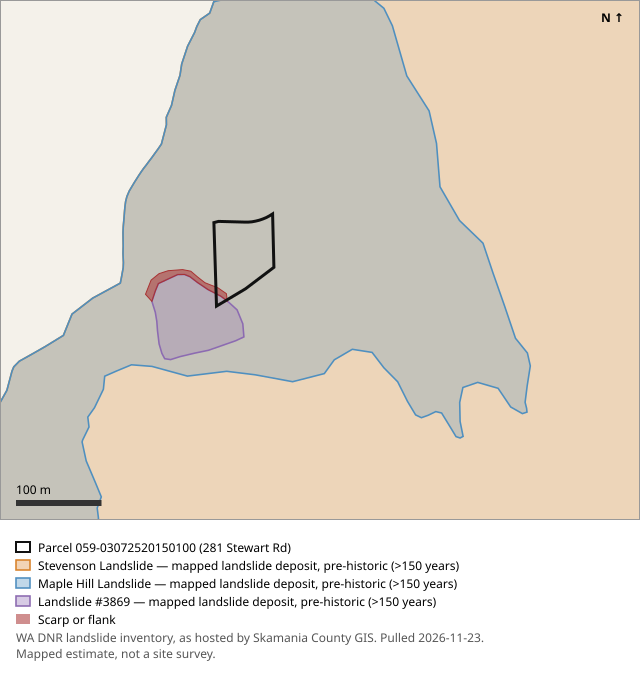

# Washington test parcel: 281 Stewart Rd, Stevenson (Skamania County)

Generated by `tools/wa-parcel-report.mjs` on **2026-11-23**. Every number below comes from a live query; the query list is at the end. Re-run the script to repeat the pull. Nothing in this report is wired into the app yet; a layer goes into the app only if it passes the bar below.

**Labels used:** Record · Mapped estimate · Claim only — not a confirmed right · Nearby, not this parcel · Not assessed yet — ask [office].

## Summary

| Need | Finding | Label |
|---|---|---|
| Parcel | 059-03072520150100, about 1.33 ac (measured from the mapped boundary) | Mapped estimate |
| Septic soil | 100% of the soil on the parcel rates **very limited** for a septic absorption field | Mapped estimate |
| Slope | mean 15.9°, max 19° (28% grade mean); 39% of the parcel steeper than 30% grade | Mapped estimate |
| Landslides | 3 mapped landslide deposit(s) on the parcel, 0 more within 100 ft. **SCC 19.07 requires a geotechnical letter.** | Mapped estimate |
| Water | Inside **STEVENSON WATER DEPT** service area — ask about a connection | Mapped estimate |
| Power | PUD NO 1 OF SKAMANIA CO; BONNEVILLE POWER ADMINISTRATION | Mapped estimate |
| Zoning | Residential 2 (R2) (Residential 2, comp plan RURAL II); city limits: outside; urban area: Stevenson | Mapped estimate |

## Check against Buildability.us

Internal validation only. These figures never appear in the app.

| Their claim | Our pull | Verdict |
|---|---|---|
| 27.5° slope | mean 15.9° (≈28% grade), max 19° over the parcel | Contradicted as degrees; matches if 27.5 is percent grade |
| Septic "very limited" | 100% very limited; reasons: Slope 8 to > 15%, Percolation 60 - 180cm (24-72") | Agrees |
| Clay soil | surface Stony clay loam, 31% clay; map unit "Steever stony clay loam, 2 to 30 percent slopes" | Partly: clay loam, not clay |

## Pass bar per layer

A layer goes into the app only when all four hold: machine access; terms allow public reuse; the pull repeats; one value checked by hand against the agency's own viewer.

| Layer | Machine access | Terms allow reuse | Repeatable | Hand-checked |
|---|---|---|---|---|
| WA statewide parcels (WaTech) | Yes | Yes — informational use, not survey | Yes — matched 2026-11-23 run | **To do** |
| USDA SDA soil | Yes | Open item — banner wording, email NRCS | Yes — matched 2026-11-23 run | **To do** (Web Soil Survey) |
| USGS 3DEP slope | Yes | Yes — federal, public domain | Yes — matched 2026-11-23 run | **To do** |
| Ecology water rights | Yes | Yes — public information, as-is | Yes — matched 2026-11-23 run | **To do** (WRTS) |
| Ecology well reports | Yes | Yes — public information, as-is | Yes — matched 2026-11-23 run | **To do** (Well Report Viewer) |
| WA DOH water service areas | Yes | To confirm | Yes — matched 2026-11-23 run | **To do** |
| Skamania landslides, zoning, city, urban | Yes | County GIS, attribution required | Yes — matched 2026-11-23 run | **To do** (county map / DNR portal) |
| Electric territory (existing /api/power layer) | Yes | Third-party HIFLD copy | Yes — matched 2026-11-23 run | **To do** (PUD service map) |
| WA DNR lidar download | No — zip only, 403 to scripts | No terms page found | — | — |
| Census geocoder for this address | **No match** — fall back to parcel address search | Yes | — | — |

## Parcel

- **Statewide parcel ID:** 059-03072520150100 · situs: 281 STEWART RD
- **Area:** 1.331 ac, measured from the mapped boundary (assessor's drawing, not a survey).
- **Land use code:** 91 · land value $125000 · building value $0
- **Centroid:** 45.71723, -121.89680
- **County record:** 03072520150100 · LOTS 15,16  BLK 3 - MAPLE HILL TRACTS  · deed acres 0 · GIS acres 1.33
- **Geocoding:** Census geocoder returned 0 match(es) for "281 Stewart Road, Stevenson, WA 98648". The parcel was found by searching the statewide layer's situs address instead.

## Soil and septic — Mapped estimate

USDA NRCS Soil Data Access, interpretation "ENG - Septic Tank Absorption Fields". 1 map unit(s) touch the parcel. Every component, minor ones included:

| Map unit | Component | Share | Major | Slope low/rep/high % | Drainage | Surface texture (clay %) | Septic rating |
|---|---|---|---|---|---|---|---|
| 123 Steever stony clay loam, 2 to 30 percent slopes | Steever | 100% | Yes | 2 / 16 / 30 | Well drained | Stony clay loam (31) | Very limited |

Limiting features: Slope 8 to > 15% (1); Percolation 60 - 180cm (24-72") (0.498).

## Slope — Mapped estimate

USGS 3DEP elevation, "Slope Degrees" over the parcel polygon. The service returns whole-degree bins. At the centroid it served raster 5022 (n46w122), elevation 286.3 m. Where 1 m lidar has a gap, the service falls back to ~10 m data, so a "1 m" request can still be 10 m underneath.

| Pixel requested | Mean | Max | Area over 15% grade | Area over 30% grade |
|---|---|---|---|---|
| 1 m | 15.9° (28%) | 19° (34%) | 100% | 39% |
| 10 m | 16.1° (29%) | 19° (34%) | 100% | 46% |

Soil-survey slope for comparison: Steever 2–16–30% (a range for the whole map unit, not this lot).

## Geologic hazards — Mapped estimate

Interactive version: [stewart-rd-landslides.geojson](WA/Skamania/stewart-rd-landslides.geojson) (GitHub renders it as a map).

Source: WA DNR landslide inventory as re-hosted by Skamania County GIS (`Landslide_Deposit`, `Scarps_and_Flanks`, `Recent_Landslides`). SCC 19.07 requires a geotechnical letter for regulated work in, or within 100 ft of, a mapped landslide hazard area, and a full report if the letter cannot clear it.

| Landslide | Name | Material / movement | Confidence | Age | Field verified | On parcel |
|---|---|---|---|---|---|---|
| 3924 | Maple Hill Landslide | Earth or debris / Complex | High (30-40) | Pre-historic (>150 years) | Yes | Yes |
| 3869 | — | Earth or debris / Flow | Moderate (11-29) | Pre-historic (>150 years) | Yes | Yes |
| 3862 | Stevenson Landslide | Earth or debris / Complex | High (30-40) | Pre-historic (>150 years) | Yes | Yes |

Scarps or flanks within 100 ft: 1. Recent landslides within 100 ft: 0.
Detailed mapping covering the parcel: Mickelson, K. A.; Jacobacci, K. E.; Contreras, T. A.; Gallin, William; Slaughter, S. L., 2018, Landslide inventory and susceptibility of the Columbia Gorge, Clark, Skamania, and Klickitat Counties, Washington: Washington Geological Survey Report of Investigation 40, 11 p. text, with 2 accompanying ESRI file geodatabases. (2018); Allen, M. D.; Richard, E. M.; Fisher, Kara; Hardesty, Josh; Mickelson, K. A.; Adams, Trent; Lambert, Crystal, 2023, Landslide inventory update of the Columbia River Gorge in Clark, Skamania, and Klickitat Counties, Washington: Washington Geological Survey Report of Investigations 45, 7 p. (2023).

What the app would say: "Mapped landslide here — Skamania County requires a geotechnical letter before building. Get 2–3 fixed-fee quotes." No dollar figure until quotes are collected.

## Water

### Public water system — Mapped estimate

- **STEVENSON WATER DEPT** (WS_ID 84250, Group A, Current, status Active, 917 connections). Contact (509) 427-5970. Source date 2019-01-01.

### Water rights — Claim only / Nearby, not this parcel

Ecology water-right documents with a place of use within 1 mile: **299**. By phase: Claim 116 · Certificate 78 · ChangeROE 44 · ChangeApplication 27 · SupersedingCertificate 14 · AdjudicatedCertificate 7 · NewApp 5 · Permit 3 · TemporaryDonation 2 · SupersedingAdjudicatedCert 2 · CertificateOfChange 1. By source class: surfaceWater 162 · groundwater 137. Claims are filings under the 1967 claims registration act, not confirmed rights; the app labels them "Claim only — not a confirmed right".

Documents whose place of use covers this parcel (2). A water system's right covering an area is not a right owned by the parcel:

| Number | Phase | Status | Source | Purpose | Priority | Quantity | Holder |
|---|---|---|---|---|---|---|---|
| S2-*18472CWRIS | Certificate | Active | surfaceWater | DM | 1964-04-29 | 0.1 CFS | Maple Hill Water Co |
| S2-01101CWRIS | Certificate | Active | surfaceWater | DM | 1968-03-26 | 0.25 CFS, 22 af/yr | Maple Hill Water Co |

### Well reports — Nearby, not this parcel

Ecology well reports within 1 mile: **493** records plotted at only **121** distinct points; 45 carry their own latitude/longitude. Most are placed at the centre of a ~40-acre quarter-quarter section, so per-well distances would be false precision. Locations approximate to about ¼ mile.

Water wells: 191 (185 with a depth). Depth: min 16 · 25th pct 180 · **median 350** · 75th pct 602 · max 1323 ft. Static water level reported on 35 (median 210 ft). Flow rate reported on 0.

By record type: Water / Water (Cased) 191 · (blank) / (blank) 68 · Soil Boring / Geotechnical 46 · Resource Protection / Resource Protection (Other) 45 · Decommissioning / Geotechnical 35 · Decommissioning / Soil Sampling 26 · Decommissioning / Monitoring 12 · Decommissioning / Water Sampling 11 · Environmental Boring / Water Sampling 11 · Soil Boring / Soil Sampling 11 · Dewatering / Dewatering 11 · Decommissioning / Dewatering 11 · Decommissioning / Water (Cased) 6 · Decommissioning / Unknown 5 · Ground Source / Ground Source Heat Pump 3 · Resource Protection / Vibrating Wire Piezometer 1.

The parcel centroid falls in **SWNW of Sec 25, T3N R7E** (BLM PLSS). Reports filed in this parcel's quarter-quarter (2) — "filed in this parcel's quarter-section", not "on this parcel":

| Type | Subtype | Depth ft | Year | File |
|---|---|---|---|---|
| Water | Water (Cased) | 1121.0 | 2024 | 2284195.pdf |
| Water | Water (Cased) | 1100.0 | 2018 | 1923731.pdf |

## Power — Mapped estimate

Territories at the centroid (the layer `/api/power` already uses): PUD NO 1 OF SKAMANIA CO; BONNEVILLE POWER ADMINISTRATION (FEDERAL). Open item: check against the PUD's own service map. A federal marketer (BPA) sells wholesale and is not who you call for a hook-up.

## County fees — Record

From the Skamania County Building / Environmental Health fee schedule ([PDF in this repo](WA/Skamania/Building_EH%20Fee%20Schedule%202023.pdf), dated 2023 — check current). Shown as separate lines, never totalled.

| Step | Fee |
|---|---|
| Soil and Site Evaluation (by the county) | $335 |
| Concurrency review of a designer's soil and site evaluation | $245 |
| Winter evaluation (weekly visits, three months) | $650 |
| Septic design review and permit, under 1,000 gal/day | $195 |
| Waiver (required for permit release) | $105 |
| Late record drawing (as-built) | $100 |
| Water Adequacy Verification, self-sampled — individual or shared well, or spring only | $265 |

The schedule lists no fee for records requests. A parcel connecting to a Group A system such as Stevenson Water likely needs no WAV (inferred from the schedule wording, not confirmed).

## Neighbor records — Not assessed yet — ask Skamania County Environmental Health

Parcels next to the test parcel (Skamania parcel layer; owner names deliberately left out):

| Parcel | Address | Property class | Acres | Relation |
|---|---|---|---|---|
| 03072520011900 | 1681 LOOP ROAD | T | 5.57 | Touching |
| 03072520160000 | 41 VIEW PLACE | T | 1.37 | Touching |
| 03072520070000 | 302 STEWART RD | T | 0.76 | Within 25 m |
| 03072520080000 | 361 STEWART RD | T | 1.7 | Within 25 m |
| 03072520090000 | 111 ROCKWOOD DR | T | 1.08 | Within 25 m |
| 03072520140000 | 81 ROCKWOOD DR | T | 1.35 | Within 25 m |

What to request for each, by parcel number and address:

- septic permits
- site evaluations and soil logs
- as-built (record) drawings
- Water Adequacy Verification records

How to request, confirmed on the county's own pages: the Environmental Health Division (under Community Development) asks for septic records by email to the Permit Center, `permitcenter@skamaniacounty.gov`, with "Septic Records Request" in the subject and the parcel number and/or address. Other county records go through the county's GovQA public records portal. Nothing is searchable online. Fees and turnaround are not stated. That neighbours' records can be requested is inferred from the Public Records Act, not stated by the county.

## Open items

- Hand-check one value per layer against the agency's own viewer (pass bar column above).
- Email NRCS about the "official Government business" banner on Soil Data Access.
- Check the electric territory against Skamania PUD's service map.
- Confirm SCC 19.07 current text, and whether "mapped" means the DNR inventory, with Skamania Community Development.
- Septic records fee and turnaround.
- No scriptable 1 m lidar where the 3DEP 1 m tile has a gap; WA DNR's lidar is zip-download only.
- Geotech letter/report cost: no public source. Collect 3–5 fixed-fee quotes before showing any figure.

## Queries run

- Census geocoder: `https://geocoding.geo.census.gov/geocoder/locations/onelineaddress?address=281+Stewart+Road%2C+Stevenson%2C+WA+98648&benchmark=Public_AR_Current&format=json`
- WA statewide parcels — address search: `https://services.arcgis.com/jsIt88o09Q0r1j8h/arcgis/rest/services/Current_Parcels/FeatureServer/0/query?f=json&where=FIPS_NR%3D%27059%27+AND+SITUS_ADDRESS+LIKE+%27281+STEWART%25%27&outFields=PARCEL_ID_NR%2CORIG_PARCEL_ID%2CSITUS_ADDRESS%2CSITUS_CITY_NM%2CLANDUSE_CD%2CVALUE_LAND%2CVALUE_BLDG%2CDATA_LINK&returnGeometry=true&outSR=4326`
- Skamania parcel layer — same parcel: `https://services3.arcgis.com/uKh72TYBlxpm42Cm/arcgis/rest/services/Parcel/FeatureServer/0/query?f=json&geometry=%3Cparcel+polygon%3E&geometryType=esriGeometryPolygon&inSR=4326&spatialRel=esriSpatialRelIntersects&outFields=PARCEL_ID%2CSitus%2CLegalDesc%2CDeedAcres%2CGIS_Acre%2CPropClass%2CSubdivName%2CAssess_URL&returnGeometry=false`
- Skamania parcels touching the test parcel: `https://services3.arcgis.com/uKh72TYBlxpm42Cm/arcgis/rest/services/Parcel/FeatureServer/0/query?f=json&geometry=%3Cparcel+polygon%3E&geometryType=esriGeometryPolygon&inSR=4326&spatialRel=esriSpatialRelIntersects&outFields=PARCEL_ID%2CSitus%2CPropClass%2CGIS_Acre&returnGeometry=false`
- Skamania parcels within 25 m: `https://services3.arcgis.com/uKh72TYBlxpm42Cm/arcgis/rest/services/Parcel/FeatureServer/0/query?f=json&geometry=%3Cparcel+polygon%3E&geometryType=esriGeometryPolygon&inSR=4326&spatialRel=esriSpatialRelIntersects&distance=25&units=esriSRUnit_Meter&outFields=PARCEL_ID%2CSitus%2CPropClass%2CGIS_Acre&returnGeometry=false`
- SDA — every component of every map unit on the parcel: `https://sdmdataaccess.nrcs.usda.gov/Tabular/post.rest (POST) SELECT mu.mukey, mu.muname, mu.musym, co.compname, co.comppct_r, co.majcompflag, co.slope_l, co.slope_r, co.slope_h, co.drainagecl, (SELECT TOP 1 ci.interphrc F…`
- SDA — septic limiting features: `https://sdmdataaccess.nrcs.usda.gov/Tabular/post.rest (POST) SELECT DISTINCT ci.rulename, ci.interphr FROM component co INNER JOIN cointerp ci ON ci.cokey = co.cokey WHERE co.mukey IN (SELECT * FROM SDA_Get_Mukey_from_int…`
- 3DEP elevation sample at centroid: `https://elevation.nationalmap.gov/arcgis/rest/services/3DEPElevation/ImageServer/getSamples?geometry=%7B%22x%22%3A-121.89679772557231%2C%22y%22%3A45.7172341534203%2C%22spatialReference%22%3A%7B%22wkid%22%3A4326%7D%7D&geometryType=esriGeometryPoint&returnFirstValueOnly=true&outFields=*&f=json`
- 3DEP slope histogram, 1 m pixel: `https://elevation.nationalmap.gov/arcgis/rest/services/3DEPElevation/ImageServer/computeStatisticsHistograms?geometry=%3Cparcel+polygon%3E&geometryType=esriGeometryPolygon&renderingRule=%7B%22rasterFunction%22%3A%22Slope+Degrees%22%7D&pixelSize=%7B%22x%22%3A1%2C%22y%22%3A1%2C%22spatialReference%22%3A%7B%22wkid%22%3A3857%7D%7D&f=json`
- 3DEP slope histogram, 10 m pixel: `https://elevation.nationalmap.gov/arcgis/rest/services/3DEPElevation/ImageServer/computeStatisticsHistograms?geometry=%3Cparcel+polygon%3E&geometryType=esriGeometryPolygon&renderingRule=%7B%22rasterFunction%22%3A%22Slope+Degrees%22%7D&pixelSize=%7B%22x%22%3A10%2C%22y%22%3A10%2C%22spatialReference%22%3A%7B%22wkid%22%3A3857%7D%7D&f=json`
- WA DOH drinking water service areas: `https://services8.arcgis.com/rGGrs6HCnw87OFOT/arcgis/rest/services/Drinking_Water_Service_Areas/FeatureServer/0/query?f=json&geometry=%3Cparcel+polygon%3E&geometryType=esriGeometryPolygon&inSR=4326&spatialRel=esriSpatialRelIntersects&outFields=WS_Name%2CWS_ID%2CWS_Grp%2CWS_Type%2CServiceAreaType%2CContact_Phone%2CWS_City%2CWS_Status%2CTotal_Conn%2CDataSourceDate%2CUpdateDateTime&returnGeometry=false`
- Ecology places of use covering the parcel: `https://services.arcgis.com/6lCKYNJLvwTXqrmp/arcgis/rest/services/WR/FeatureServer/6/query?f=json&geometry=%3Cparcel+polygon%3E&geometryType=esriGeometryPolygon&inSR=4326&spatialRel=esriSpatialRelIntersects&outFields=WR_DOC_ID%2CWR_Doc_Type_CD&returnGeometry=false`
- Ecology places of use within 1 mile: `https://services.arcgis.com/6lCKYNJLvwTXqrmp/arcgis/rest/services/WR/FeatureServer/6/query?f=json&geometry=%7B%22x%22%3A-121.89679772557231%2C%22y%22%3A45.7172341534203%2C%22spatialReference%22%3A%7B%22wkid%22%3A4326%7D%7D&geometryType=esriGeometryPoint&inSR=4326&spatialRel=esriSpatialRelIntersects&distance=1609.344&units=esriSRUnit_Meter&outFields=WR_DOC_ID%2CWR_Doc_Type_CD&returnGeometry=false`
- Ecology water-right records (batch 1): `https://services.arcgis.com/6lCKYNJLvwTXqrmp/arcgis/rest/services/WR/FeatureServer/10/query?f=json&where=WR_Doc_ID+IN+%28%3C150+ids%3E%29&outFields=WR_Doc_ID%2CWaRecPhaseTypeCode%2CWaRecProcessStatusTypeCode%2CWaRecRCWClassTypeCode%2CWaRecPrimaryNumber%2CPriorityDate%2CPurposeOfUseTypeCodes%2CInstantaneousQuantity%2CInstantaneousUnitCode%2CAnnualVolumeQuantity%2CPersonLastOrOrganizationNM%2CPersonFirstNM%2CPartyRoleTypeCode&returnGeometry=false`
- Ecology water-right records (batch 2): `https://services.arcgis.com/6lCKYNJLvwTXqrmp/arcgis/rest/services/WR/FeatureServer/10/query?f=json&where=WR_Doc_ID+IN+%28%3C149+ids%3E%29&outFields=WR_Doc_ID%2CWaRecPhaseTypeCode%2CWaRecProcessStatusTypeCode%2CWaRecRCWClassTypeCode%2CWaRecPrimaryNumber%2CPriorityDate%2CPurposeOfUseTypeCodes%2CInstantaneousQuantity%2CInstantaneousUnitCode%2CAnnualVolumeQuantity%2CPersonLastOrOrganizationNM%2CPersonFirstNM%2CPartyRoleTypeCode&returnGeometry=false`
- BLM PLSS quarter-quarter at the parcel centroid: `https://gis.blm.gov/arcgis/rest/services/Cadastral/BLM_Natl_PLSS_CadNSDI/MapServer/3/query?f=json&geometry=%7B%22x%22%3A-121.89679772557231%2C%22y%22%3A45.7172341534203%2C%22spatialReference%22%3A%7B%22wkid%22%3A4326%7D%7D&geometryType=esriGeometryPoint&inSR=4326&spatialRel=esriSpatialRelIntersects&outFields=TWNSHPNO%2CTWNSHPDIR%2CRANGENO%2CRANGEDIR%2CFRSTDIVNO%2CQQSEC&returnGeometry=false`
- Ecology well reports within 1 mile (IDs): `https://services.arcgis.com/6lCKYNJLvwTXqrmp/arcgis/rest/services/WR/FeatureServer/9/query?f=json&geometry=%7B%22x%22%3A-121.89679772557231%2C%22y%22%3A45.7172341534203%2C%22spatialReference%22%3A%7B%22wkid%22%3A4326%7D%7D&geometryType=esriGeometryPoint&inSR=4326&spatialRel=esriSpatialRelIntersects&distance=1609.344&units=esriSRUnit_Meter&returnIdsOnly=true`
- Ecology well reports (batch 1): `https://services.arcgis.com/6lCKYNJLvwTXqrmp/arcgis/rest/services/WR/FeatureServer/9/query?f=json&objectIds=%3C200+ids%3E&outFields=OBJECTID%2CWellProjectType%2CWellSubType%2CCompletedDepth%2CStaticWaterLvl%2CFlowRateGPM%2CWorkCompletionDate%2CTownshipNr%2CRangeNr%2CSectionNr%2CQtr%2CQtrQtr%2CLatitudeDecimalQuantity%2CFileName&returnGeometry=true&outSR=4326`
- Ecology well reports (batch 2): `https://services.arcgis.com/6lCKYNJLvwTXqrmp/arcgis/rest/services/WR/FeatureServer/9/query?f=json&objectIds=%3C200+ids%3E&outFields=OBJECTID%2CWellProjectType%2CWellSubType%2CCompletedDepth%2CStaticWaterLvl%2CFlowRateGPM%2CWorkCompletionDate%2CTownshipNr%2CRangeNr%2CSectionNr%2CQtr%2CQtrQtr%2CLatitudeDecimalQuantity%2CFileName&returnGeometry=true&outSR=4326`
- Ecology well reports (batch 3): `https://services.arcgis.com/6lCKYNJLvwTXqrmp/arcgis/rest/services/WR/FeatureServer/9/query?f=json&objectIds=%3C93+ids%3E&outFields=OBJECTID%2CWellProjectType%2CWellSubType%2CCompletedDepth%2CStaticWaterLvl%2CFlowRateGPM%2CWorkCompletionDate%2CTownshipNr%2CRangeNr%2CSectionNr%2CQtr%2CQtrQtr%2CLatitudeDecimalQuantity%2CFileName&returnGeometry=true&outSR=4326`
- Skamania deposits intersecting the parcel: `https://services3.arcgis.com/uKh72TYBlxpm42Cm/arcgis/rest/services/Landslide_Deposit/FeatureServer/21/query?f=json&geometry=%3Cparcel+polygon%3E&geometryType=esriGeometryPolygon&inSR=4326&spatialRel=esriSpatialRelIntersects&outFields=LANDSLIDE_ID%2CLS_NAME%2CMATERIAL%2CMOVEMENT%2CCONFIDENCE%2CRELATIVE_AGE%2CFIELD_VERIFIED&returnGeometry=false`
- Skamania deposits within 100 ft of the parcel (SCC 19.07 trigger): `https://services3.arcgis.com/uKh72TYBlxpm42Cm/arcgis/rest/services/Landslide_Deposit/FeatureServer/21/query?f=json&geometry=%3Cparcel+polygon%3E&geometryType=esriGeometryPolygon&inSR=4326&spatialRel=esriSpatialRelIntersects&distance=30.48&units=esriSRUnit_Meter&outFields=LANDSLIDE_ID%2CLS_NAME%2CMATERIAL%2CMOVEMENT%2CCONFIDENCE%2CRELATIVE_AGE%2CFIELD_VERIFIED&returnGeometry=true&outSR=4326&geometryPrecision=6`
- Skamania scarps intersecting the parcel: `https://services3.arcgis.com/uKh72TYBlxpm42Cm/arcgis/rest/services/Scarps_and_Flanks/FeatureServer/3/query?f=json&geometry=%3Cparcel+polygon%3E&geometryType=esriGeometryPolygon&inSR=4326&spatialRel=esriSpatialRelIntersects&outFields=LANDSLIDE_ID%2CSCARP_FLANK_ID&returnGeometry=false`
- Skamania scarps within 100 ft of the parcel (SCC 19.07 trigger): `https://services3.arcgis.com/uKh72TYBlxpm42Cm/arcgis/rest/services/Scarps_and_Flanks/FeatureServer/3/query?f=json&geometry=%3Cparcel+polygon%3E&geometryType=esriGeometryPolygon&inSR=4326&spatialRel=esriSpatialRelIntersects&distance=30.48&units=esriSRUnit_Meter&outFields=LANDSLIDE_ID%2CSCARP_FLANK_ID&returnGeometry=true&outSR=4326&geometryPrecision=6`
- Skamania recent intersecting the parcel: `https://services3.arcgis.com/uKh72TYBlxpm42Cm/arcgis/rest/services/Recent_Landslides/FeatureServer/1/query?f=json&geometry=%3Cparcel+polygon%3E&geometryType=esriGeometryPolygon&inSR=4326&spatialRel=esriSpatialRelIntersects&outFields=*&returnGeometry=false`
- Skamania recent within 100 ft of the parcel (SCC 19.07 trigger): `https://services3.arcgis.com/uKh72TYBlxpm42Cm/arcgis/rest/services/Recent_Landslides/FeatureServer/1/query?f=json&geometry=%3Cparcel+polygon%3E&geometryType=esriGeometryPolygon&inSR=4326&spatialRel=esriSpatialRelIntersects&distance=30.48&units=esriSRUnit_Meter&outFields=*&returnGeometry=false&outSR=4326&geometryPrecision=6`
- Skamania landslide study areas covering the parcel: `https://services3.arcgis.com/uKh72TYBlxpm42Cm/arcgis/rest/services/Study_Areas/FeatureServer/12/query?f=json&geometry=%3Cparcel+polygon%3E&geometryType=esriGeometryPolygon&inSR=4326&spatialRel=esriSpatialRelIntersects&outFields=CITATION_CODE%2CYR_PUBLISHED%2CCITATION%2CURL&returnGeometry=false`
- Skamania zoning: `https://services3.arcgis.com/uKh72TYBlxpm42Cm/arcgis/rest/services/Zoning_Designation/FeatureServer/0/query?f=json&geometry=%3Cparcel+polygon%3E&geometryType=esriGeometryPolygon&inSR=4326&spatialRel=esriSpatialRelIntersects&outFields=Zoning%2CZoneCode%2CZoneDesc%2CCompPlan%2CZoning_URL&returnGeometry=false`
- Skamania city limits: `https://services3.arcgis.com/uKh72TYBlxpm42Cm/arcgis/rest/services/CityLimits/FeatureServer/0/query?f=json&geometry=%3Cparcel+polygon%3E&geometryType=esriGeometryPolygon&inSR=4326&spatialRel=esriSpatialRelIntersects&outFields=CITY_NAME&returnGeometry=false`
- Skamania urban areas: `https://services3.arcgis.com/uKh72TYBlxpm42Cm/arcgis/rest/services/Urban_Areas/FeatureServer/0/query?f=json&geometry=%3Cparcel+polygon%3E&geometryType=esriGeometryPolygon&inSR=4326&spatialRel=esriSpatialRelIntersects&outFields=Name%2CAcres&returnGeometry=false`
- Electric retail service territories (layer used by /api/power): `https://services6.arcgis.com/BAJNi3EgCdtQ1BCG/arcgis/rest/services/Electric_Retail_Service_Territories/FeatureServer/0/query?f=json&geometry=%7B%22x%22%3A-121.89679772557231%2C%22y%22%3A45.7172341534203%2C%22spatialReference%22%3A%7B%22wkid%22%3A4326%7D%7D&geometryType=esriGeometryPoint&inSR=4326&spatialRel=esriSpatialRelIntersects&outFields=NAME%2CTYPE&returnGeometry=false`
